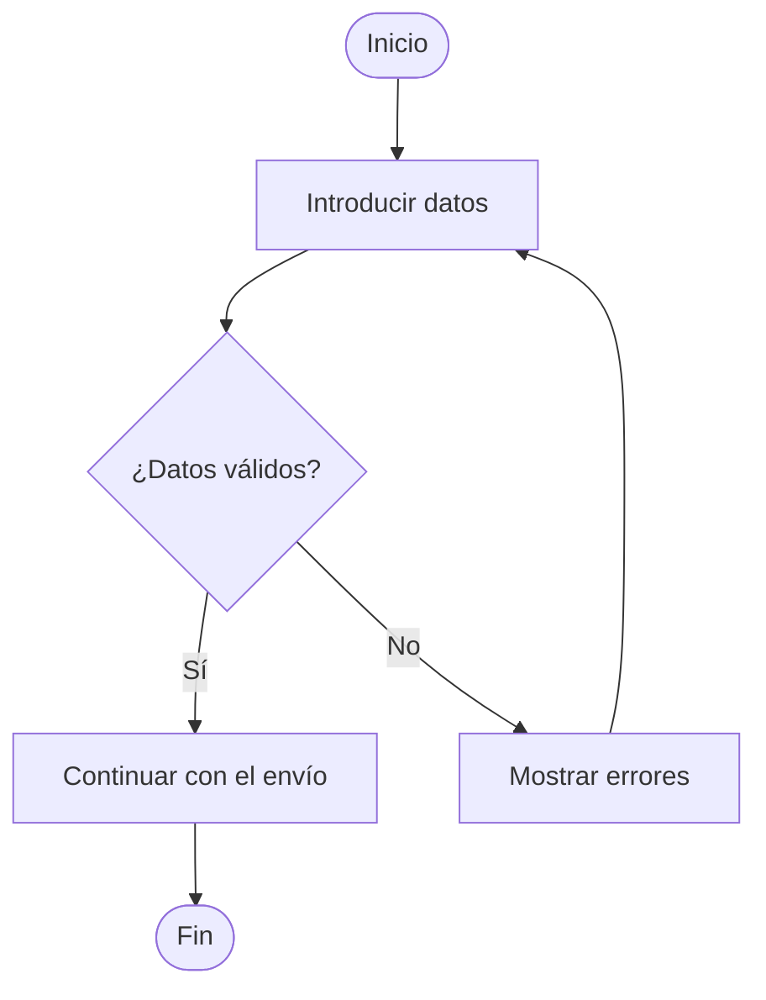

# 05. Diagramas de flujo

## Cómo elaborarlos

1. Selecciona un proceso concreto.
2. Define el inicio y el final.
3. Representa las acciones en orden.
4. Usa decisiones cuando haya condiciones con caminos alternativos.
5. Etiqueta las salidas de cada decisión.
6. Comprueba que no existan caminos sin salida ni pasos ambiguos.

Símbolos habituales: óvalo para inicio/fin, rectángulo para proceso, rombo para decisión y flechas para indicar el orden.

## Plantilla vacía

- **Nombre del proceso:** [Nombre]
- **Objetivo:** [Qué representa]
- **Inicio:** [Evento inicial]
- **Entradas:** [Datos necesarios]
- **Decisiones:** [Condiciones]
- **Finales posibles:** [Resultados]

[Insertar diagrama del proceso.]

## Ejemplo ficticio: validar formulario

Este diagrama solo representa un comportamiento propuesto. No demuestra que el formulario esté implementado.

## Lista de comprobación

- [ ] El proceso tiene inicio y final.
- [ ] Las decisiones están formuladas como condiciones.
- [ ] Todas las salidas de decisión están identificadas.
- [ ] El diagrama coincide con los requisitos.
