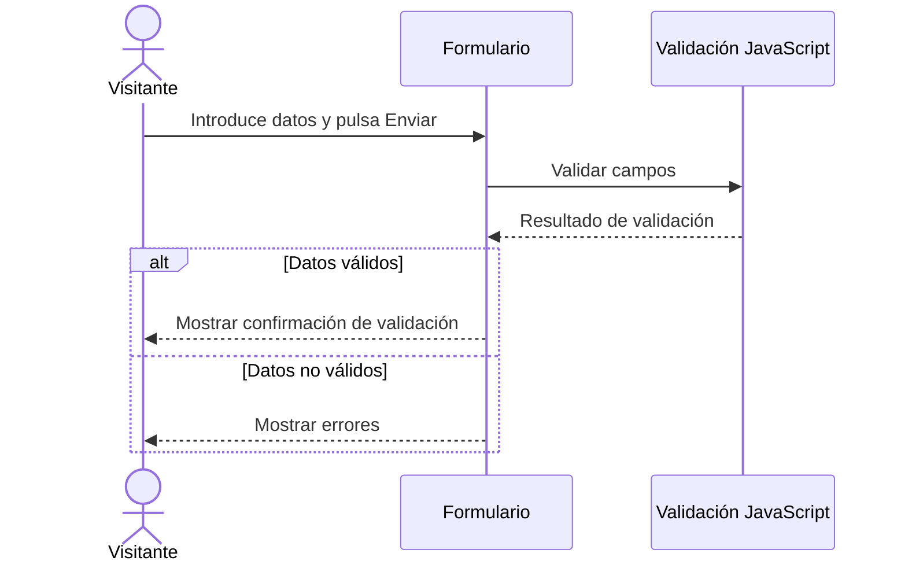

# 06. Diagramas de secuencia

## Cómo elaborarlos

1. Escoge un caso de uso.
2. Identifica los participantes que intercambian mensajes.
3. Ordénalos de izquierda a derecha.
4. Representa los mensajes de arriba abajo según suceden.
5. Incluye alternativas si existen resultados diferentes.
6. No dibujes servidores o bases de datos que el proyecto no utilice.

## Plantilla vacía

- **Caso de uso relacionado:** [CU-XXX]
- **Objetivo:** [Interacción representada]
- **Participantes:** [Lista]
- **Flujo principal:** [Descripción]
- **Alternativas:** [Condiciones y resultados]

[Insertar diagrama de secuencia.]

## Ejemplo ficticio: validación en el navegador

El ejemplo solo muestra validación en el cliente. No implica que se envíen datos a un servidor.

## Lista de comprobación

- [ ] Los participantes existen en la arquitectura propuesta.
- [ ] Los mensajes siguen un orden coherente.
- [ ] Las alternativas reflejan el comportamiento esperado.
- [ ] El diagrama corresponde a un caso de uso identificado.
